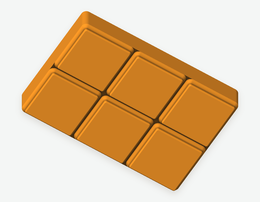
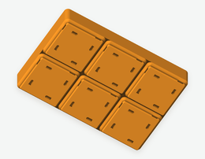
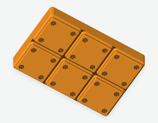
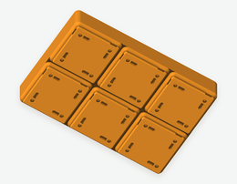
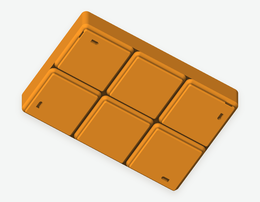
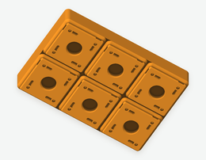
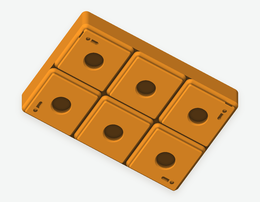
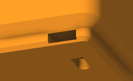
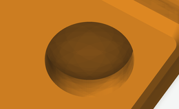
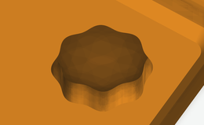

# Gridfinity Rebase

CLI for replacing Gridfinity bin bases with configurable presets or a base copied from another STL.

[](https://buymeacoffee.com/skrajewski)

## Install

Available on [PyPI as `gridfinity-rebase`](https://pypi.org/project/gridfinity-rebase/).
Requires Python 3.10+.

### With uv

Use [uv](https://docs.astral.sh/uv/) to run the CLI without installing it permanently:

```sh
uvx gridfinity-rebase bin.stl --preset magnet-holes
```

Or install it as a command available from any directory:

```sh
uv tool install gridfinity-rebase
gridfinity-rebase bin.stl --preset magnet-holes
```

### With pip

Create and activate a virtual environment, then install the package:

```sh
python -m venv .venv
source .venv/bin/activate
python -m pip install gridfinity-rebase
gridfinity-rebase bin.stl --preset magnet-holes
```

### From source

To install a local checkout, run this command from the repository root:

```sh
uv tool install .
```

## Usage

> [!IMPORTANT]
> I tested this CLI tool **only** on macOS machine.

Pass an STL file to replace its base. You can also use the explicit
`gridfinity-rebase rebase` subcommand. Run `gridfinity-rebase` without arguments
to display help.

```sh
# Create smooth bottom-loading magnet pockets in bin-rebased-magnet-holes.stl.
gridfinity-rebase bin.stl --preset magnet-holes

# Create side-loading magnet pockets in bin-rebased-rebuilt.stl.
gridfinity-rebase bin.stl --preset rebuilt

# Create screw holes without magnet pockets in bin-rebased-screws.stl.
gridfinity-rebase bin.stl --screws

# Add screw holes to bottom-loading press-fit pockets
gridfinity-rebase bin.stl --preset press-fit --screws

# Place magnet pockets and screw holes only at the four outer corners of the bin.
gridfinity-rebase bin.stl --preset rebuilt --screws --only-corners

# Add side-loading magnet pockets and an M15x1.5 thumbscrew hole.
# The output is bin-rebased-rebuilt-thumbscrew.stl.
gridfinity-rebase bin.stl --preset rebuilt --thumbscrew

# Copy a base from another bin
gridfinity-rebase bin.stl --base donor.stl -o result.stl

# Inspect a model or list presets
gridfinity-rebase inspect bin.stl
gridfinity-rebase presets
```

## Presets

Available presets: `plain`, `magnet-holes`, `rebuilt` and `press-fit`.
`refined` is an alias for `rebuilt`.

`magnet-holes` creates smooth bottom-loading Ø6.5 × 2.4 mm pockets without ribs.
`press-fit` adds eight crush ribs to each pocket. You can also get this geometry
with `--preset magnet-holes --crush-ribs`.

The previews show the same 2×3 example bin from underneath. Click a preview for the full-size image.
Append the options in each row to `gridfinity-rebase bin.stl`.

| Preview | Preset | Options |
| --- | --- | --- |
| [](docs/images/base-plain-2x3.png) | `plain` creates standard feet without magnet pockets or screw holes. | `--preset plain` |
| [](docs/images/base-magnet-holes-2x3.png) | `magnet-holes` creates four Ø6.5 mm magnet pockets per foot, 2.4 mm deep, without crush ribs. | `--preset magnet-holes` |
| [](docs/images/base-rebuilt-2x3.png) | `rebuilt` creates four pockets per foot in a fan pattern, with one opening per edge. Small underside slots let you remove magnets. | `--preset rebuilt` |
| [](docs/images/base-press-fit-2x3.png) | `press-fit` creates four bottom-loading pockets per foot, each with eight crush ribs. | `--preset press-fit` |

### Geometry options

The default preset is `plain`. Select another preset or change individual settings:

- `--magnets none|side|bottom`: no magnet pockets, side-loading pockets, or bottom-loading pockets.
- `--side-pocket-height MM`: set the side-loading pocket height. The default is 2.1 mm.
- `--screws` / `--no-screws`: enable or disable 3 mm screw bores.
- `--crush-ribs` / `--no-crush-ribs`: enable or disable ribs in bottom-loading pockets.
- `--only-corners`: limit magnet pockets and 3 mm screw bores to the four outer corners of the whole bin, regardless of grid size. A 1×1 bin keeps all four holes. Central `--thumbscrew` holes still appear in every foot.
- `--thumbscrew` / `--no-thumbscrew`: enable or disable the central threaded hole.

### Examples with geometry options

Add flags to a preset to combine magnet pockets, screws and central threads,
or to place magnet pockets and screw bores only at the outer corners.

| Preview | Description | Options |
| --- | --- | --- |
| [](docs/images/base-rebuilt-screws-2x3.png) | Each side-loading pocket has a Ø3 mm screw bore. | `--preset rebuilt --screws` |
| [](docs/images/base-screws-2x3.png) | Each foot has four Ø3 mm screw bores without magnet pockets. | `--screws` |
| [](docs/images/base-press-fit-screws-2x3.png) | Bottom-loading pockets have crush ribs and screw bores in their floors. | `--preset press-fit --screws` |
| [](docs/images/base-rebuilt-thumbscrew-2x3.png) | Each foot has side-loading pockets and a central M15×1.5 threaded hole. | `--preset rebuilt --thumbscrew` |
| [](docs/images/base-rebuilt-only-corners-2x3.png) | The whole bin has four side-loading pockets, one at each outer corner, instead of 24. | `--preset rebuilt --only-corners` |
| [](docs/images/base-rebuilt-screws-thumbscrew-2x3.png) | The bin has 24 side pockets, 24 screw bores and six central threaded holes. | `--preset rebuilt --screws --thumbscrew` |
| [](docs/images/base-rebuilt-screws-thumbscrew-only-corners-2x3.png) | The whole bin has four side pockets and four screw bores at its outer corners. All six feet have a central threaded hole. | `--preset rebuilt --screws --thumbscrew --only-corners` |

### Close-ups

| Preview | Description | Options |
| --- | --- | --- |
| [](docs/images/detail-side-loading.png) | The magnet slides through the opening in the edge of the foot. | `--preset rebuilt` |
| [](docs/images/detail-magnet-holes.png) | Insert the magnet into the circular recess from underneath. | `--preset magnet-holes` |
| [](docs/images/detail-crush-ribs.png) | Eight ribs narrow the pocket for a press fit. | `--preset press-fit` |
| [](docs/images/detail-thumbscrew.png) | The M15×1.5 threaded hole is 4.75 mm deep, with a solid bridge above. | `--preset rebuilt --thumbscrew` |

The images show geometry generated by the CLI. [Regenerate the graphics](docs/images/README.md).

See [curve resolution](docs/segments.md) for `--segments` settings and visual comparisons.

## Key details

- The CLI supports standard rectangular Gridfinity bins on a 42 mm grid. Use millimeters for STL units, with feet at the bottom and Z pointing up.
- The CLI detects the base and cut height. It preserves the bin interior and geometry above the cut, and rejects invalid meshes, incompatible bases and ambiguous models.
- A donor base can match the input grid or have its X/Y dimensions swapped. The CLI can also tile a 1×1 donor base across the input.
- Unmodified presets write to `bin-rebased-PRESET.stl`. `--thumbscrew` and `--only-corners` append their names to the filename. Modified settings use a descriptive suffix, such as `bin-rebased-magnets-bottom-crush-ribs-screws.stl`. Donor bases use `bin-rebased.stl`. Use `-o` to choose a filename and `--overwrite` to replace an existing output.
- JSON reports include the resolved `geometry` settings. `base` identifies the starting preset or donor path. The default preset is `plain`. For donor bases, `geometry` is `null`.
- `--base-height MM` overrides automatic detection for custom models and replaces everything below that height. The minimum is 4.75 mm.

Run `gridfinity-rebase --help` for all options.

## Performance

Run the benchmark from the repository root:

```sh
uv run --locked --python 3.11 python scripts/benchmark.py --runs 5
```

The benchmark generates all test models locally. You do not need to download example STLs.
See [benchmark instructions, methodology and reference results](docs/performance.md)
for JSON output and environment details.

## AI Disclosure

Szymon here. I used AI to build this tool.

I needed a way for quick replacement of base of custom Grdifnity bins downloaded from Internet, but I didn't want to spend too much of my free time on this. I collaborated with the AI, describing how it should work, how I want to use it and what's the important from the both code perspective and end-user perspective. It allowed me to iterate and create something that is exactly what I needed. Now I share it with you.

Just want you to know.

## License

The [MIT license](LICENSE) covers this CLI and its adapted preset implementation.

Processing a model does not replace its existing license or attribution
requirements. When sharing a rebased STL, preserve applicable notices and
comply with the licenses of the input model and any donor geometry.

## Acknowledgements

Preset geometry is adapted from the MIT-licensed [Gridfinity Rebuilt implementation](https://github.com/kennetek/gridfinity-rebuilt-openscad/tree/910e22d8607fd7f5f51ad5e5cbc5287a76810bfd)
by Kenneth Hodson, based on Gridfinity by Zack Freedman. Rebuilt credits
[Gridfinity Refined](https://www.printables.com/model/413761-gridfinity-refined)
by grizzie17 as the source of its side-loading magnet pockets.

Rebuilt source files at revision `910e22d8607fd7f5f51ad5e5cbc5287a76810bfd`:

- [standard.scad](https://github.com/kennetek/gridfinity-rebuilt-openscad/blob/910e22d8607fd7f5f51ad5e5cbc5287a76810bfd/src/core/standard.scad): mating profile, grid, radii and hole dimensions.
- [gridfinity-rebuilt-holes.scad](https://github.com/kennetek/gridfinity-rebuilt-openscad/blob/910e22d8607fd7f5f51ad5e5cbc5287a76810bfd/src/core/gridfinity-rebuilt-holes.scad): side-loading magnet pockets and crush ribs.
- [base.scad](https://github.com/kennetek/gridfinity-rebuilt-openscad/blob/910e22d8607fd7f5f51ad5e5cbc5287a76810bfd/src/core/base.scad): fan arrangement of the four pockets and the central threaded hole.

The native thumbscrew thread tessellation derives from `ScrewThread()` in
[threads-scad](https://github.com/kennetek/gridfinity-rebuilt-openscad/blob/910e22d8607fd7f5f51ad5e5cbc5287a76810bfd/src/external/threads-scad/threads.scad),
created in 2016 — 2017 by Ryan A. Colyer and released under [CC0 1.0](https://creativecommons.org/publicdomain/zero/1.0/).
