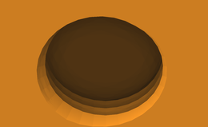
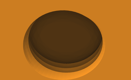

# Curve resolution: `--segments`

`--segments N` controls how finely curves in the generated base are approximated
by straight edges. A circular hole uses **N segments around its circumference**;
each rounded 90° corner uses **N / 4 segments**. The setting applies to the foot
profile, the rounded bridge above the feet, magnet pockets (including crush ribs),
screw bores and the central `--thumbscrew` thread. It is not the total number of
triangles in the model.

The default is **64**. Accepted values are **32–256, in multiples of 8**
(for example, 32, 64, 96, 128 or 256). Higher values make curved outlines and
surfaces smoother, at the cost of more triangles, larger STL files and generally
longer geometry processing. Doubling this value does not necessarily double the
final triangle count or processing time: both also depend on the selected
features, grid size and input mesh.

| Setting | Segments per 90° corner | When to use it |
| --- | --- | --- |
| `--segments 32` | 8 | Quick previews and smaller meshes; facets are more visible, especially on the thread. |
| `--segments 64` | 16 | The default starting point for everyday models. |
| `--segments 128` | 32 | Finer curves when faceting is still noticeable at 64. |
| `--segments 256` | 64 | Maximum supported resolution, useful for detailed close-ups and fine curved geometry. |

The three images below show the same M15×1.5 threaded hole from underneath,
with identical camera, magnification and lighting. Click to inspect the full-size
renders; differences are easier to see there than in the thumbnails.

| 32 segments | 64 segments (default) | 256 segments |
| --- | --- | --- |
| [](images/detail-segments-32.png) | [](images/detail-segments-64.png) | [](images/detail-segments-256.png) |

```sh
gridfinity-rebase rebase bin.stl --preset rebuilt --thumbscrew --segments 128
```

This changes tessellation, while keeping the nominal dimensions, thread pitch
and configured clearances. Coarse polygonal curves can still affect the fit of
printed holes and threads; a higher value alone does not guarantee a better fit,
which also depends on printing accuracy. Only newly generated geometry uses
this setting. It does not smooth the retained input mesh, and has no effect when
copying a donor base with `--base`.

`--segments` does not add a suffix to the output filename. Use `-o` with distinct
names to keep several resolutions for comparison.

